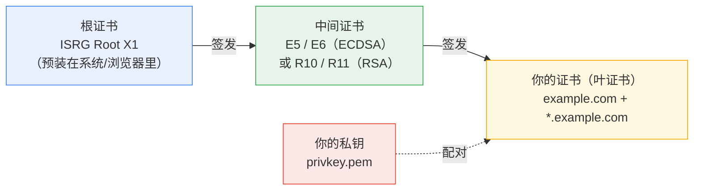

# 证书基础：域名层级、CSR/SAN 与那一堆 .pem 文件

> 面向第一次亲手申请 HTTPS 证书的人。读完你应该能回答：
> 为什么申请 `*.example.com` 还要单独加上 `example.com`？
> CSR 和 SAN 到底在干什么？为什么签出来的证书是一堆文件而不是一个？

---

## 0. 一句话版本

- **apex** = 域名最顶上那一层，即 `example.com` 本身，也叫裸域名。泛域名 `*.example.com` **不包含**它。
- **CSR** = 你写给 CA 的「申请书」，里面装着你的**公钥**和「我要这些域名」，用你的**私钥**签名。私钥本身永远不交出去。
- **SAN** = 证书里真正声明「这张证书覆盖哪些域名」的字段，现代浏览器**只看它，不看 CN**。
- **多个 .pem 文件** = 信任链的分层。服务器要发的是「你的证书 + 中间证书」拼起来的 `fullchain.pem`，私钥单独放 `privkey.pem`。

---

## 1. 域名层级：apex、子域、泛域名

### 1.1 apex 是什么

`apex` 英文原意是「顶点、最高点」。在 DNS 里，一个域名的各级标签是从右往左读的树：

```
                    .（根）
                    │
                  com
                    │
              example.com        ← 这里是 apex（顶点）
                    │
        ┌───────────┼───────────┐
    www          api         shop
        │
   a.www（更深一层）
```

`example.com` 处在这棵树的最顶端（相对于它自己的子域而言），所以叫 **apex domain**（顶点域）。

它还有一堆同义词，在各种面板、文档里混着用，容易看懵：

| 叫法 | 含义 |
| --- | --- |
| apex domain | 顶点域（DNS 术语，最准确） |
| bare domain / naked domain | 裸域名（不带 `www`） |
| root domain | 根域名（相对子域而言，不是 DNS 的根 `.`） |
| zone apex | 区域顶点（DNS 配置里的说法） |
| `@` 主机记录 | 在域名服务商的解析面板里，`@` 就代表 apex |

**一句话：`example.com` 就是 apex，`www.example.com` 不是。**

### 1.2 为什么 apex 总被单独拎出来说

两个原因，一个来自 DNS，一个来自证书。

**DNS 层面的坑**：`CNAME` 记录不能与别的记录共存（RFC 1034）。而 apex 上必须有 `SOA` 和 `NS` 记录，所以 **apex 不能设 CNAME**。这就是为什么你接入 CDN 时，厂商会说要开「CNAME 拉平 / ANAME / ALIAS」——本质都是绕过这条限制。很多 CDN 因此只支持加速 `www` 子域，apex 得用别的方式（比如把 apex 301 跳到 `www`）。

**证书层面的坑**：泛域名**不覆盖** apex，下面细说。

### 1.3 泛域名不是万能的

`*.example.com` 里的 `*` 在证书规范（RFC 6125）里**只匹配一个标签（label）**，而且**不能是空**。

| 证书里写了 | 能覆盖 | 不能覆盖 |
| --- | --- | --- |
| `*.example.com` | `www.example.com`、`api.example.com`、`a.example.com` | `example.com`（apex 本身）、`a.b.example.com`（跨了两级）、`wwwexample.com` |
| `*.example.com` + `example.com` | 上面全部，以及 apex | `a.b.example.com` |
| `www.example.com` | 只有 `www.example.com` | 其它任何名字 |

所以：

- 想要「主域名 + 所有一级子域」都能用 HTTPS，**必须把 `*.example.com` 和 `example.com` 两个都写进申请**。这也是本工具第 1 步提示「泛域名不含 `example.com` 本身，需要的话两个都写上」的原因。
- 三个文件里最容易出问题的就是这一类：证书申请下来了，浏览器打开 `https://example.com` 还是报错，因为那张证书里根本没有 `example.com` 这个名字。

> 补充一个细节：`*` 只能出现在最左边，`a.*.example.com` 这种写法 CA 一律拒绝。

---

## 2. CSR：写给 CA 的「申请书」

### 2.1 全流程长什么样

```
你的机器                                    CA（Let's Encrypt）
─────────                                   ──────────────────
1. 生成密钥对
   privkey.pem（私钥，永不外传）
   public key （公钥）

2. 用私钥签一份 CSR ────── CSR ──────────▶  3. 验签：确认你确实持有私钥
   （内含公钥 + 域名列表）                    4. 核对域名是否与订单一致
                                              5. 用 CA 自己的私钥签发证书
                          ◀──── 证书 ──────      （把你的公钥写进证书）
```

CSR 全称 **Certificate Signing Request**（证书签名请求），格式是 PKCS#10。它是一段 Base64 文本，`-----BEGIN CERTIFICATE REQUEST-----` 开头，里面装着三样东西：

| 内容 | 说明 |
| --- | --- |
| **公钥** | 与你的私钥配对的那一半。CA 会把它原样放进最终证书 |
| **主体信息**（Subject） | 主要是 `CN`（Common Name）字段，老式写法里放域名 |
| **扩展** | 最重要的是 `SAN`（见下一节） |
| **签名** | 用你的**私钥**对上面全部内容做的签名，证明这份申请书确实出自私钥持有者 |

### 2.2 关键点：私钥永远不出本机

CSR 里**只有公钥**。CA 从头到尾看不到你的私钥，也不需要看到——这是公钥密码学的意义所在。

所以本工具里 `privkey.pem` 会被设成仅当前用户可读（`0600`），而 CSR 是一次性的中间产物，用完即弃，不会落盘。

### 2.3 CN：一个正在退场的老字段

早期（SSL 时代）一张证书只能给一个域名用，域名就写在 `CN` 里，比如 `CN=www.example.com`。后来需要一张证书覆盖多个域名，于是有了 `SAN`。

现在的规则是：

- **Chrome 58（2017 年）起，所有主流浏览器完全不看 CN**，只认 SAN。
- 但为了兼容极老的客户端，CA 和工具通常还是会把一个域名填进 CN。
- CN 的长度上限是 64 字符（X.509 规范 `ub-common-name`），超长域名只能省略 CN、全靠 SAN。

> **这就是你之前遇到的那个报错的来源。**
> 报错「`CSR does not specify same identifiers as Order`」的意思是：CSR 里声明的域名集合，和订单里的域名集合不一致。
> Boulder（LE 的 CA 程序）比对时会把 **CN（非空时）+ SAN 合起来去重**再和订单标识比。老版本的 `build_csr` 用 `base_domain_of()` 生成 CN，把 `*.example.com` 剥成了 `example.com` —— 这个 CN 不在订单里，于是集合对不上，签发被拒。修法是让 CN 原样保留 `*.`，或者干脆省略 CN。

---

## 3. SAN：证书真正覆盖哪些域名

**SAN = Subject Alternative Name**（主题备用名称），是 X.509 v3 的一个扩展字段（OID `2.5.29.17`）。

你可以把它理解成证书封面上的一行清单：

```
这张证书适用于：
  DNS: example.com
  DNS: *.example.com
```

SAN 不只放域名，还能放 IP 地址、邮箱、URI，但 HTTPS 场景下用的就是 `dNSName` 类型。

几个实用结论：

| 问题 | 答案 |
| --- | --- |
| 浏览器怎么判断证书合不合法？ | 拿访问的域名去 SAN 列表里逐条匹配，匹配上才算过 |
| CN 还有用吗？ | 现代浏览器不用了，只为兼容老古董保留 |
| 一张证书能放多少个域名？ | Let's Encrypt 上限 100 个（含泛域名） |
| 加域名要重新签吗？ | 要。SAN 在签发时就固定了，改不了 |
| 怎么查一张证书覆盖了哪些域名？ | `openssl x509 -in cert.pem -noout -text`，看 `X509v3 Subject Alternative Name` 那一段 |

再强调一遍顺序：**先说清楚「要哪些域名」→ CA 按这个清单建订单 → 你提交的 CSR 必须与清单完全一致 → CA 把清单原样写进证书的 SAN**。这条链上任何一环对不上，都会在最后一步签发时炸掉——这几乎是自建 ACME 客户端最常见的坑。

---

## 4. 为什么证书是多个文件：信任链

### 4.1 信任是「链式」建立的

你的浏览器信任大约 150 个「根证书」（预装在操作系统或浏览器里）。但 CA 不会拿根证书的私钥直接给你签证书——根私钥一旦泄露，整个 PKI 体系就废了。所以中间加了一层：



验证时客户端从下往上走：**你的证书 → 中间证书 → 根证书**，最后发现根证书在自己信任库里，整条链成立。

> 中间证书的名字（E5/E6、R10/R11 等）会随 CA 轮换变化，**不要在任何配置里硬编码文件名**，永远用「从证书包里读出来的实际内容」。

### 4.2 四个文件的分工

CA 返回的其实是一个「证书包」（chain），本工具把它拆成了几个文件：

| 文件 | 内容 | 给谁看 | 说明 |
| --- | --- | --- | --- |
| `privkey.pem` | **私钥** | 只有服务器 | 唯一的秘密。泄露 = 别人可以冒充你的网站。权限 `0600` |
| `cert.pem` | 叶证书（只有你自己的） | 内部使用 | 单独一张。**直接用它会出问题**，见下节 |
| `chain.pem` | 中间证书（可能 1～2 张） | 内部使用 | 用来补全信任链，不含根证书 |
| `fullchain.pem` | `cert.pem` + `chain.pem` 拼接 | **服务器配置用这个** | 绝大多数场景的唯一正确答案 |
| `cert-info.json` | 元信息（到期时间、SAN、序列号等） | 你自己看 | 不是证书，是给人看的摘要 |

用一条命令就能看清楚它们的区别：

```bash
grep -c "BEGIN CERTIFICATE" cert.pem chain.pem fullchain.pem
# cert.pem:      1   ← 一张
# chain.pem:     1   ← 一张（有时是 2，某些 CA 有交叉签名）
# fullchain.pem: 2   ← 加起来
```

### 4.3 为什么必须用 fullchain，而不是 cert.pem

只部署 `cert.pem` 时，服务器**只把自己的证书**发给客户端，客户端手上没有中间证书，链就断了：

- **Chrome / Edge / Firefox**：通常会顺着证书里的 AIA 字段去自动下载中间证书，所以你可能「看起来一切正常」。
- **curl、Java、Node.js、Python requests、老 Android、微信内置浏览器**：不会或不能自动补下载，直接报 `unable to get local issuer certificate` 或 `certificate verify failed`。

这是最典型的一类「我电脑上打开没问题，用户却说证书错误」的故障。**统一用 `fullchain.pem` 就没这个问题。**

反过来，也不要把**根证书**塞进 `fullchain.pem`：客户端本来就有，多传只是浪费握手带宽，个别严格的客户端还会觉得莫名其妙。

---

## 5. 各种服务器该用哪几个文件

| 环境 | 证书配置 | 私钥配置 |
| --- | --- | --- |
| **Nginx** | `ssl_certificate fullchain.pem;` | `ssl_certificate_key privkey.pem;` |
| **Apache 2.4.8+** | `SSLCertificateFile fullchain.pem` | `SSLCertificateKeyFile privkey.pem` |
| **Apache < 2.4.8** | `SSLCertificateFile cert.pem` + `SSLCertificateChainFile chain.pem` | `SSLCertificateKeyFile privkey.pem` |
| **Node.js / Express** | `cert: fs.readFileSync('fullchain.pem')` | `key: fs.readFileSync('privkey.pem')` |
| **IIS** | 需要 `.pfx`（PEM 不认），见下方转换命令 | 打包在 pfx 里 |
| **Tomcat / Java** | 需要 JKS 或 PKCS#12 | 同上 |
| **Caddy** | 直接用 PEM 对，或让它自己申请 | — |

**Nginx**（推荐写法）：

```nginx
server {
    listen 443 ssl;
    server_name example.com www.example.com;

    ssl_certificate     /path/to/fullchain.pem;
    ssl_certificate_key /path/to/privkey.pem;
}
```

**IIS / 需要 pfx 的场景**：

```bash
openssl pkcs12 -export -out cert.pfx \
  -inkey privkey.pem \
  -in cert.pem \
  -certfile chain.pem
```

**Tomcat / Java**：

```bash
openssl pkcs12 -export -out cert.p12 \
  -inkey privkey.pem -in cert.pem -certfile chain.pem
keytool -importkeystore -srckeystore cert.p12 -srcstoretype PKCS12 \
  -destkeystore cert.jks -deststoretype JKS
```

---

## 6. 自己动手验证

拿到证书别急着部署，先用几条命令确认它是对的。

**① 看这张证书到底覆盖了哪些域名**

```bash
openssl x509 -in cert.pem -noout -text | grep -A1 "Subject Alternative Name"
# X509v3 Subject Alternative Name:
#     DNS:example.com, DNS:*.example.com
```

对着你申请的域名清单核一遍，尤其别忘了 apex。

**② 验证信任链是否完整**

```bash
openssl verify -untrusted chain.pem cert.pem
# cert.pem: OK
```

如果只写 `openssl verify cert.pem`，会因为没有中间证书而失败——这正好演示了「客户端只有叶证书时会遇到什么」。

**③ 确认私钥和证书是配对的**

```bash
diff <(openssl x509 -in cert.pem -noout -pubkey) \
     <(openssl pkey -in privkey.pem -pubout) \
  && echo "配对正常"
```

没有输出且打印「配对正常」就对了。如果服务器启动报 `key values mismatch` / `private key does not match`，就是这两个文件不是一对（常见于新旧证书覆盖时漏了一个）。

**④ 看有效期**

```bash
openssl x509 -in cert.pem -noout -dates
# notBefore=Oct 27 08:00:00 2026 GMT
# notAfter=Jan 25 07:59:59 2027 GMT
```

**⑤ 线上实际发出的链对不对**

```bash
openssl s_client -connect example.com:443 -servername example.com </dev/null 2>/dev/null \
  | grep -E "^(depth|verify)"
```

如果输出里有 `verify error:num=21:unable to verify the first certificate`，说明中间证书没配——回去检查是不是只部署了 `cert.pem`。

---

## 7. 常见误区速查

| 误区 | 实际情况 |
| --- | --- |
| 泛域名 `*.x.com` 包含 `x.com` | 不包含。必须两个都申请 |
| `*.x.com` 能覆盖 `a.b.x.com` | 不能。`*` 只匹配一级 |
| 证书文件越多越好，干脆把根证书也拼进去 | 不要。`fullchain` = 叶 + 中间，根由客户端自带 |
| 只部署 `cert.pem` 就完事 | 浏览器可能自动补中间证书，但 curl/Java/Node/老安卓会失败 |
| 换证书只覆盖 `cert.pem`，私钥不用动 | 私钥可以不换（续期时复用），但必须确认新旧文件配对 |
| CN 里没写域名，证书就无效 | 现代浏览器只看 SAN，CN 可有可无 |
| CSR 里包含私钥 | 不包含。CSR 只有公钥 + 签名 |
| 证书 90 天到期，能续成长期的 | 不能。所有公有 CA 的证书都被限制在 398 天以内，LE 固定 90 天，只能重复申请 |

---

## 8. 术语速查表

| 术语 | 全称 | 一句话 |
| --- | --- | --- |
| **apex** | zone apex | 域名顶点，`example.com` 本身（不含任何前缀） |
| **CSR** | Certificate Signing Request | 用私钥签名的申请书，含公钥 + 域名清单 |
| **CN** | Common Name | 老式「证书域名」字段，现代浏览器已忽略 |
| **SAN** | Subject Alternative Name | 证书真正的域名清单，浏览器只看这个 |
| **ACME** | Automatic Certificate Management Environment | 自动化签发协议（RFC 8555），Let's Encrypt 用的就是它 |
| **order** | — | 订单。一条「我要这些域名的证书」的申请记录，状态从 `pending` → `ready` → `valid` |
| **authorization** | — | 授权。订单里每个域名一份，记录「这个域名验证过了没有」 |
| **challenge** | — | 挑战。证明域名归属的具体动作，如 `http-01`（放文件）、`dns-01`（加 TXT 记录） |
| **leaf** | leaf certificate | 叶证书，就是给你域名签的那张 |
| **intermediate** | intermediate certificate | 中间证书，由根签发、用来签你的证书 |
| **root** | root certificate | 根证书，自签名，预装在系统信任库里 |
| **chain** | certificate chain | 信任链：叶 → 中间 → 根 |
| **fullchain** | — | 叶 + 中间拼在一起的文件，服务器发这个 |
| **PEM** | Privacy Enhanced Mail | 就是 Base64 文本格式，`-----BEGIN ...-----` 那种 |
| **PKCS#12 / pfx** | — | 把证书 + 中间证书 + 私钥打包成一个二进制文件，Windows/Java 用 |

---

## 延伸阅读

- RFC 8555（ACME 协议）：<https://datatracker.ietf.org/doc/html/rfc8555>
- RFC 6125（证书里的域名匹配规则，通配符只匹配一级就是这里定的）：<https://datatracker.ietf.org/doc/html/rfc6125>
- Let's Encrypt 官方文档：<https://letsencrypt.org/docs/>
- 证书透明度日志查询（看你的域名签发过哪些证书）：<https://crt.sh>
